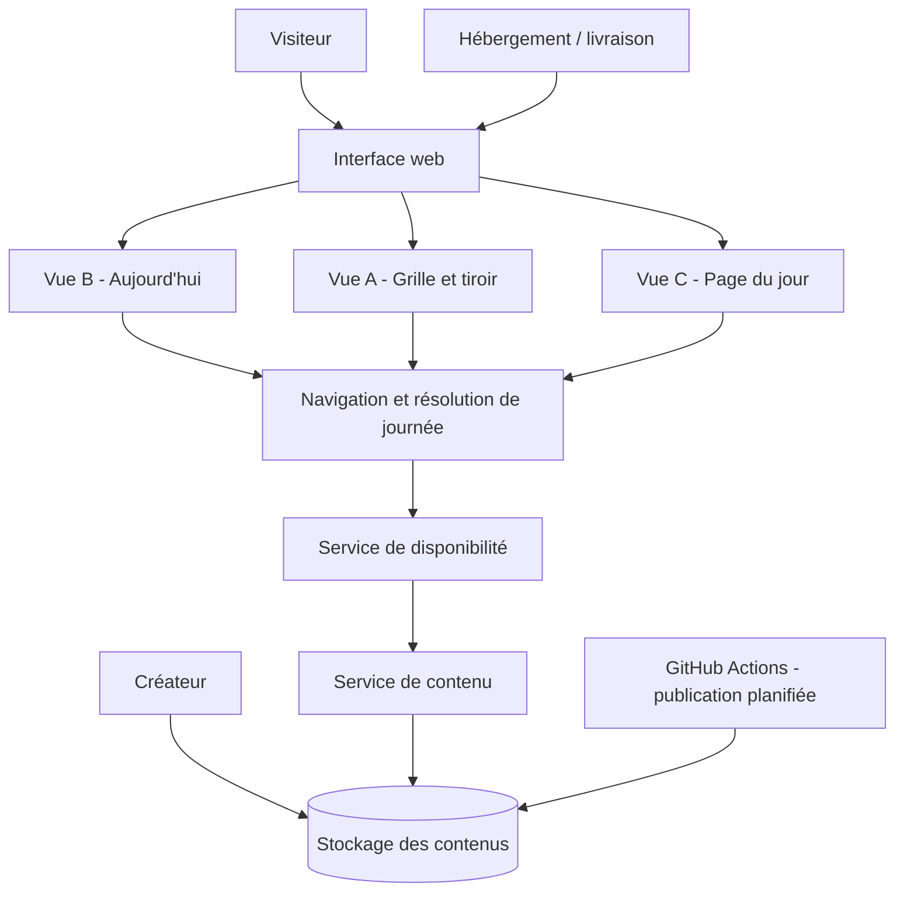

# System Architecture

## 1. Objectif et statut

Ce document décrit une architecture logique cible pour le Calendrier de l'Avent.

Il sépare les responsabilités fonctionnelles afin que les vues A, B et C utilisent les mêmes contenus et les mêmes règles d'accès.

**Statut : proposition d'architecture, non implémentée intégralement.**

Le kit de départ indique que l'application est construite avec un agent et ne fournit pas de code applicatif initial. Il impose Git, GitHub et GitHub Actions, mais laisse le choix de la solution technique au projet, dans la limite de la simplicité nécessaire.

## 2. Principes d'architecture

1. Une seule entité Calendrier.
2. Une collection de 24 contenus, identifiés par leur numéro de jour.
3. Trois vues de présentation : A, B et C.
4. Une logique de disponibilité commune aux trois vues.
5. Le contrôle d'accès aux contenus futurs est effectué côté serveur ou par le mécanisme de publication, jamais uniquement côté interface.
6. La publication quotidienne est automatisée.
7. Les contenus et secrets ne sont pas exposés dans un emplacement public avant leur date.

## 3. Vue logique



Le diagramme représente des responsabilités logiques. Il ne prescrit pas encore un framework, un fournisseur d'hébergement ou une base de données.

## 4. Couches fonctionnelles

### 4.1 Présentation — Frontend

Responsabilités :

- afficher les vues A, B et C ;
- présenter les 24 cases et leurs états ;
- afficher le contenu autorisé ;
- gérer les interactions tactiles et les commandes visibles ;
- fournir les liens partageables ;
- afficher les retours de chargement, d'erreur et de verrouillage.

La présentation ne décide pas seule si un contenu futur est autorisé.

### 4.2 Navigation et routage

Responsabilités :

- ouvrir la vue B sur l'URL principale ;
- ouvrir la vue A depuis le raccourci `Grille` ;
- résoudre une URL de journée pour la vue C ;
- conserver le numéro de jour sélectionné lors du changement de vue ;
- traiter les navigations précédente et suivante ;
- empêcher les navigations vers un jour inexistant ou non disponible.

Forme d'URL cible proposée :

- `/` : vue B ;
- `/grille` : vue A, si une URL dédiée est utile ;
- `/jour/5` : vue C pour le jour 5.

Les chemins ci-dessus sont une proposition de routage. Le prototype Low-fi V1 utilise actuellement des fragments d'URL (`#jour-5`) et ne prouve pas que des routes serveur sont déjà configurées.

### 4.3 Domaine — Calendrier et disponibilité

Responsabilités :

- connaître la date courante du calendrier ;
- déterminer le numéro de jour courant ;
- déterminer si une case est disponible ;
- appliquer la règle de consultation des jours passés ;
- refuser les jours futurs ;
- partager la même décision entre A, B et C.

Cette logique doit être indépendante du composant visuel qui demande le contenu.

### 4.4 Contenus

Responsabilités :

- stocker les 24 cases ;
- associer chaque contenu à un numéro de jour unique ;
- fournir le titre, le corps, le format et les liens éventuels ;
- vérifier qu'aucun jour n'est dupliqué ou vide ;
- ne pas exposer publiquement les contenus futurs.

Le kit demande au minimum que chaque case porte son jour, de 1 à 24. Le format de stockage final reste à choisir.

### 4.5 Publication planifiée

Responsabilités :

- exécuter une tâche automatique selon le calendrier ;
- rendre disponible le bon contenu à la bonne date ;
- utiliser GitHub Actions, imposé par le kit ;
- éviter de publier les contenus futurs trop tôt ;
- signaler clairement les échecs de publication.

La fréquence et le fuseau horaire exacts du déclenchement doivent être définis avant la mise en production.

### 4.6 Hébergement et livraison

Responsabilités :

- servir l'application ;
- fournir les pages et contenus autorisés ;
- gérer les routes directes de journées ;
- empêcher qu'une route future révèle le contenu ;
- fournir une URL stable à partager.

Le fournisseur et le mode de rendu (statique, serveur ou hybride) ne sont pas décidés dans les sources actuelles.

## 5. Modèle de données logique

Le modèle ci-dessous décrit les informations nécessaires. Il ne constitue pas encore un schéma de base de données imposé.

### Calendar

| Champ | Rôle |
| --- | --- |
| `id` | Identifiant du calendrier |
| `title` | Titre du calendrier |
| `year` | Année du calendrier |
| `timezone` | Fuseau horaire de référence, à décider |
| `start_date` | Date du premier jour |
| `end_date` | Date du dernier jour |

### CalendarDay

| Champ | Rôle |
| --- | --- |
| `day_number` | Numéro unique, de 1 à 24 |
| `date` | Date civile correspondante |
| `title` | Titre de la case |
| `body` | Contenu de la case |
| `content_type` | Type de contenu : anecdote, défi, recette, quiz, etc. |
| `links` | Liens associés éventuels |
| `publication_status` | État éditorial / publication |
| `published_at` | Date et heure de disponibilité effective |

### VisitorReadState — optionnel

| Champ | Rôle |
| --- | --- |
| `visitor_id` | Identifiant du visiteur, si un mécanisme d'identification existe |
| `day_number` | Journée consultée |
| `read_at` | Date de consultation |

Ce modèle de lecture est facultatif. Le projet n'a pas encore décidé s'il doit mémoriser les lectures. La disponibilité d'une case et sa lecture sont deux états distincts.

## 6. Règle de disponibilité

Règle logique minimale :

```text
if requested_day < 1 or requested_day > 24:
    reject request

if requested_day is in the future:
    do not return the content

otherwise:
    return the content, subject to the past-day policy
```

La comparaison de dates doit utiliser le fuseau horaire de référence du calendrier.

La politique d'accès aux jours passés reste une décision produit. Si les jours passés restent consultables, le contenu publié doit rester disponible. Si l'accès est limité au jour courant, cette restriction doit être appliquée par le même service de disponibilité.

## 7. Sécurité et confidentialité des contenus

Le kit indique explicitement que le contenu d'une case future ne doit pas être rangé à un endroit où un visiteur peut le lire avant sa date.

Conséquences d'architecture :

- masquer le contenu avec CSS ou JavaScript n'est pas une protection suffisante ;
- désactiver le bouton d'une case future n'est pas une protection suffisante ;
- une URL directe ne doit pas permettre de récupérer le contenu futur ;
- une API publique ne doit pas retourner les 24 contenus non filtrés ;
- les contenus futurs ne doivent pas être intégrés dans un fichier JavaScript public ou un JSON public complet ;
- les secrets et variables privées ne doivent pas être committés dans le dépôt.

Deux stratégies de mise en œuvre sont possibles, à choisir au palier technique concerné :

1. **Publication progressive** : ne rendre public que le contenu du jour et les contenus déjà publiés.
2. **Stockage privé avec contrôle serveur** : conserver les 24 contenus dans un stockage non public et ne retourner que les jours autorisés.

## 8. Git et automatisation

Exigences issues du kit :

- Git suit le projet dès le démarrage ;
- la branche principale s'appelle `main` ;
- un `.gitignore` exclut notamment `.env`, clés, certificats, dépendances et fichiers de build ;
- un point de sauvegarde est créé après chaque étape fonctionnelle et avant les changements risqués ;
- les messages de sauvegarde sont en français, sur une ligne, avec un verbe au présent ;
- GitHub est utilisé pour le dépôt distant lorsque demandé ;
- GitHub Actions est utilisé pour la tâche automatique de publication ;
- les secrets nécessaires à l'automatisation sont stockés dans les secrets GitHub, pas dans les fichiers suivis.

## 9. Vérifications système

### Données

- exactement 24 journées ;
- numéros de 1 à 24 sans doublon ;
- aucun contenu obligatoire vide ;
- chaque lien associé est valide et approprié.

### Accès

- une journée passée suit la politique choisie ;
- la journée courante est accessible ;
- une journée future est inaccessible ;
- une URL directe future ne retourne pas le contenu ;
- le passage par A, B, C ou Swipe ne contourne pas le contrôle.

### Publication

- le bon jour est publié à la bonne date ;
- le fuseau horaire est cohérent ;
- un échec de tâche automatique est détectable ;
- le contenu futur n'est pas exposé avant publication.

### Interface

- les trois vues affichent le même contenu pour une même journée ;
- le numéro de jour reste cohérent lors des changements de vue ;
- les gestes ne bloquent pas le scroll vertical ;
- les commandes visibles restent utilisables sans geste tactile.

## 10. Hors périmètre tant que non décidé

- compte utilisateur et authentification des visiteurs ;
- profil ou historique de lecture ;
- commentaires, réactions ou notifications ;
- interface d'administration intégrée ;
- choix du framework frontend ;
- choix du fournisseur d'hébergement ;
- choix d'une base de données ;
- analytics et suivi comportemental.
